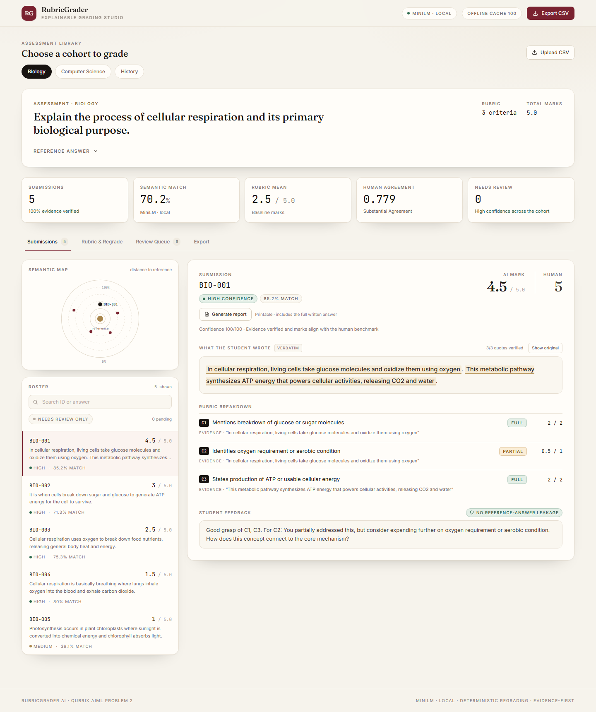
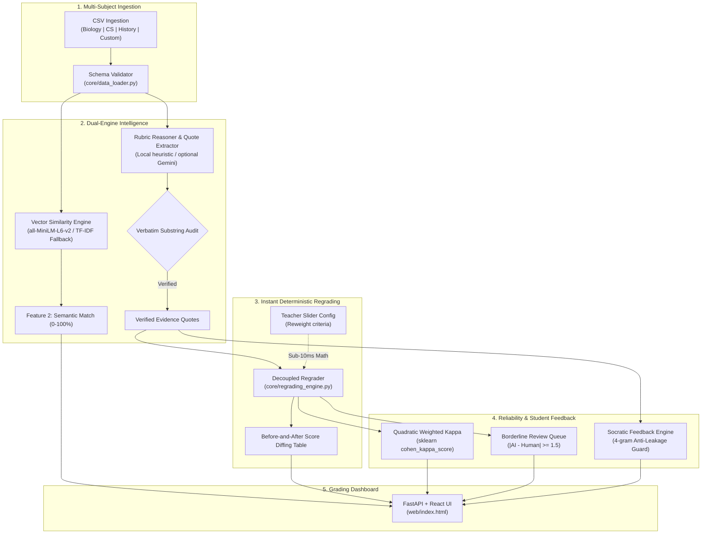

# RubricGrader AI 🎓
### Rubric-Based Short-Answer Grader with Verbatim Evidence & Instant Regrading
**QUBRIX 12-Hour Internal Hackathon • AIML Problem 2 (EdTech)**

---

## 🚀 Overview

Grading subjective written answers is notoriously slow, plagued by inter-teacher inconsistency, and breaks whenever rubrics evolve mid-evaluation.

**RubricGrader AI** is an explainable, auditable grading assistant that:
1. Scores short answers against configurable multi-point rubrics across any subject.
2. Backs every mark with an **exact verbatim quote** highlighted directly in the student's text.
3. Provides **socratic constructive feedback** without leaking the canonical model answer.
4. Measures human grading agreement using **Quadratic Weighted Kappa (QWK)** and flags borderline cases for manual review.
5. Enables **millisecond-scale dynamic re-grading** (typically 4–8 ms once warm) when teachers alter point weights or split criteria, rendering instant Before-and-After score comparison diffs without model retraining.

---

## 🖥️ Live Grading Dashboard



The app-first dashboard (`web/index.html`, served by FastAPI) has no marketing landing page. Everything a teacher needs is one screen:

- **Assessment library** — three cohorts (Biology, Computer Science, History) plus drag-and-drop CSV upload for any unseen rubric.
- **Cohort header** — the question, rubric size, total marks and a collapsible reference answer.
- **Five KPI cards** — submissions, semantic match, live rubric mean, QWK human agreement and the pending review count.
- **Submissions** — a searchable roster, a semantic map of the cohort, and a detail pane with **What the student wrote** (verbatim, with an evidence-highlight toggle), confidence reasons and a **Generate report** button.
- **Printable report** — a self-contained evaluation report per submission with the question, the student's full written answer, rubric decisions and quotes, marks, confidence and feedback. Print it or save it as PDF from the browser; the reference answer is deliberately omitted.
- **Rubric & Regrade** — in-page weight sliders with a live before/after diff table, plain-English justifications, QWK shift and recalculation latency.
- **Review Queue** — flagged or low-confidence submissions with approve/undo, routed to the exported CSV.
- **Export** — one click downloads the graded results using the weights and approvals currently on screen.

---

## 🏛️ System Architecture



---

## 🌟 Hackathon Problem 2 Feature Matrix

| # | Required Feature | How RubricGrader AI Implements It | Verified In |
|---|---|---|---|
| **1** | **Batch Input** | Ingests questions, model answers, rubrics, and student batches across three benchmark subjects plus any uploaded CSV rubric, with schema validation. | `core/data_loader.py` |
| **2** | **Overall Score** | Computes cosine similarity between student answer and model answer using dense sentence vectors (`all-MiniLM-L6-v2`). | `core/similarity_engine.py` |
| **3** | **Per-Criterion Rubric Scoring** | Evaluates each rubric point as `FULL`, `PARTIAL`, or `NONE` and highlights exact verbatim evidence quotes in `<mark>` tags. | `core/rubric_evaluator.py`<br>`core/visualizer.py` |
| **4** | **Student-Facing Feedback** | Generates formative socratic feedback on missed points with automated 4-gram leakage detection preventing answer key spoilers. | `core/feedback_engine.py` |
| **5** | **Reliability Analysis** | Measures human agreement with **Quadratic Weighted Kappa (QWK)** and routes borderline answers ($|AI - Human| \ge 1.5$) to a teacher queue. | `core/metrics.py` |
| **6** | **Dynamic Regrading & Diffing** | Decouples qualitative state from point math, recalculating all student grades in **single-digit milliseconds once warm** and showing live Before/After diffs with justifications. | `core/regrading_engine.py` |

### Product hardening

| Addition | What it does | Verified in |
|---|---|---|
| **Graded CSV export** | One download with effective marks for the current weights, every criterion's decision/max/evidence quote, semantic band, confidence score and reasons, review flag, teacher approval and feedback. UTF-8 BOM so Excel opens it cleanly. | `backend_api.py` (`/api/export_csv`), Export tab |
| **Confidence & uncertainty** | 100-point confidence from unverified quotes, weak semantic alignment and AI–human gaps; `High`/`Medium`/`Low` labels with plain-English reasons. Low confidence and gaps ≥ 1.5 marks route to the review queue. | `_compute_confidence`, `web/index.html` mirror |
| **Printable evaluation report** | Per-submission HTML report with the question, the student's verbatim answer, every rubric decision and evidence quote, confidence, feedback and review state. Opens in a new tab with Print / Save as PDF and Download HTML actions; the reference answer is omitted so it can be shared. | `GET /api/report`, Generate report button |
| **Visible human loop** | Review badges in the roster and detail pane, a dedicated queue with pending/flagged counts, approve/undo, and approvals carried into the export. | Review Queue tab |
| **Offline / rate-limit resilience** | Local MiniLM embeddings, a pre-warmed disk evaluation cache and a lexical TF-IDF fallback. The engine badge always states which path produced the marks. | `core/cache_manager.py`, `core/similarity_engine.py` |
| **UI polish** | Warm paper palette, serif display type, an SVG semantic map, verified-quote highlighting, live KPI cards, QWK shift cards and a responsive layout down to 390 px. | `web/index.html` |

---

## ⚡ Quickstart Guide

### 1. Prerequisites
Python 3.10+ (tested on Python 3.13). No Node.js build step — the dashboard ships as a single server-rendered HTML app.

### 2. Setup Virtual Environment & Dependencies
```bash
python -m venv venv
venv\Scripts\activate
pip install -r requirements.txt
```
The first run downloads the `all-MiniLM-L6-v2` embedding model into the local Hugging Face cache. If it cannot be loaded, the app falls back to TF-IDF and labels the engine honestly instead of failing.

### 3. Optional Configuration
```bash
copy .env.example .env
```
Nothing is required to run the demo. `GEMINI_API_KEY` is only read by the legacy Streamlit reasoning path; the FastAPI dashboard uses the local deterministic rubric reasoner. See `.env.example` for the single optional key.

### 4. Run Automated Verification Tests
```bash
python -m unittest discover -s tests
# Expected output: Ran 36 tests - OK
```

### 5. Launch the Grading Dashboard (primary UI)
```bash
python -m uvicorn backend_api:app --host 127.0.0.1 --port 8000
```
Open `http://localhost:8000`. FastAPI serves `web/index.html` and the JSON API; the page keeps working from the evaluation cache if the embedding model is unavailable.

### 6. Optional: Streamlit Research Dashboard
```bash
streamlit run app.py --server.port 8501
```
Open your browser to `http://localhost:8501`.

---

## ⏱️ 2-Minute Live Demo Pitch Script

* **[0:00 - 0:25] The Hook**:
  *"Judges, grading written short answers is slow and two teachers often give the same answer completely different marks. Worst of all, halfway through grading an exam, the grading rubric changes—forcing teachers to manually re-grade dozens of papers from scratch. We built **RubricGrader AI** to make grading fast, transparent, and instantly adaptable."*
* **[0:25 - 0:50] Multi-Subject Batch Ingestion & Vector Matching**:
  *(Click Biology → Computer Science → History in the assessment library, then show an uploaded CSV)*
  *"Here we load the same pipeline across our three benchmark subjects, and any uploaded CSV rubric works with no code changes. Our system calculates two separate perspectives: a dense vector Semantic Match Index against the model answer and an itemized rubric evaluation."*
* **[0:50 - 1:15] Verbatim Evidence Proof & Non-Leaking Feedback**:
  *(Select a submission in the Submissions tab)*
  *"Notice the student's text. Every single mark is backed by a color-coded `<mark>` quote verified directly from the student's words—zero black-box hallucinations. Below it, our socratic feedback engine tells the student what they missed while mathematically guaranteeing zero answer key leaks."*
* **[1:15 - 1:40] The WOW Moment: Sub-10ms Dynamic Regrading**:
  *(Open 'Rubric & Regrade' and drag a weight slider)*
  *"Now, watch what happens when the teacher revises a rubric—say Criterion 1 was too strict and is increased from 2 to 4 marks. In under 10 milliseconds, all students are regraded. This Before-and-After table shows exactly who gained or lost marks and provides a plain-English explanation for every shift, without calling an API or retraining a model."*
* **[1:40 - 2:00] Reliability & Human Trust**:
  *(Open 'Review Queue', then 'Export')*
  *"We don't ask teachers to blindly trust AI. We publish Quadratic Weighted Kappa for every cohort — 0.64 to 0.78 across the three built-in subjects, and the lowest-agreement cohort is exactly where the review queue lights up. Approve a mark, generate a printable report for any student, or download the CSV: current weights, evidence quotes, confidence reasons and your approvals all travel with it."*

---

## 🎯 Anticipated Judge Q&A

**Q1: How does your dynamic regrading work so fast without calling an LLM?**  
> **Answer**: We use a **Decoupled Architecture**. The qualitative comprehension step—determining if a student met a criterion as `FULL`, `PARTIAL`, or `NONE`—is done once. The scoring math is a pure linear calculation in Python ($Marks = Weight \times Multiplier$). Adjusting weights takes under 5 milliseconds on 50 answers with 100% mathematical precision.

**Q2: What happens if the venue Wi-Fi goes down during the demo?**  
> **Answer**: The application is 100% offline-resilient. It uses local sentence vector embeddings (`all-MiniLM-L6-v2`) with automatic Scikit-Learn TF-IDF fallback, and features a disk cache in `data/cache/` that pre-warms all benchmark fixtures.

**Q3: How do you guarantee the feedback doesn't leak the exam answers?**  
> **Answer**: Our `FeedbackEngine` uses an automated 4-gram overlap detector. If any sequence of 4 or more consecutive words from the teacher's model answer appears in the student feedback, it is automatically flagged and sanitized into a conceptual guiding question.

---

## 🧪 Tech Stack
- **API & App UI**: FastAPI 0.163 + Uvicorn, React 18 and Tailwind via CDN (no build step)
- **Semantic Vectors**: Sentence-Transformers (`all-MiniLM-L6-v2`) + Scikit-Learn TF-IDF fallback
- **Psychometrics**: Scikit-Learn `cohen_kappa_score(..., weights="quadratic")`
- **Data Engineering**: Pandas 3.1
- **Rubric Reasoning**: Local deterministic heuristics by default; optional Google Gemini path in the legacy Streamlit app
- **Research Dashboard**: Streamlit 1.67

See `LEARNING.md` for a five-sentence "explain it to a judge" summary and the design rationale.
